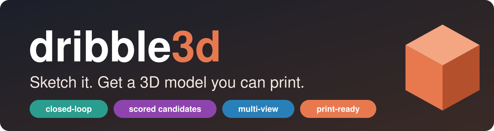
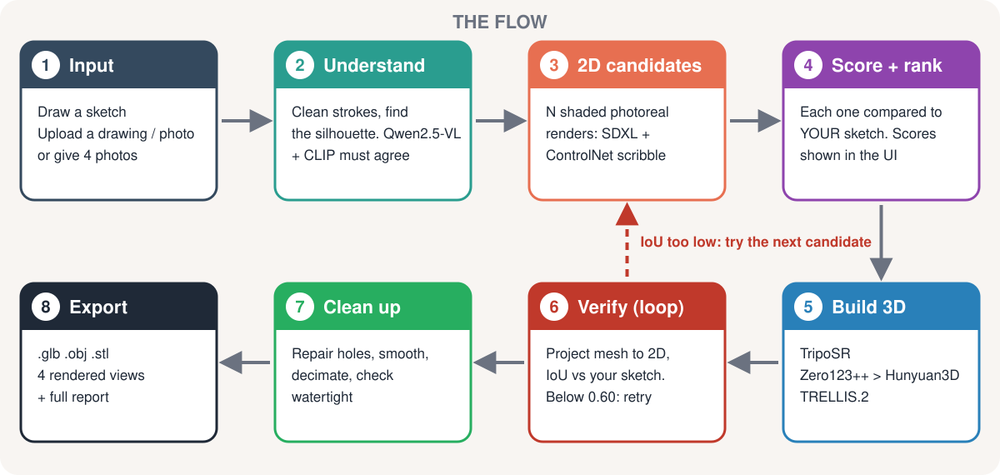
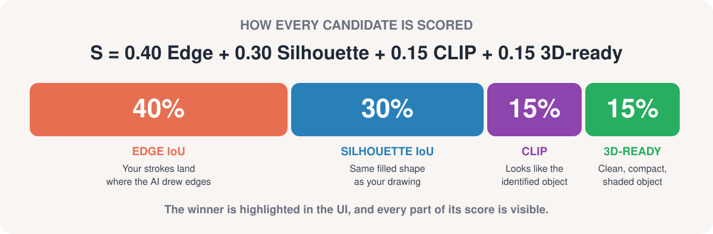
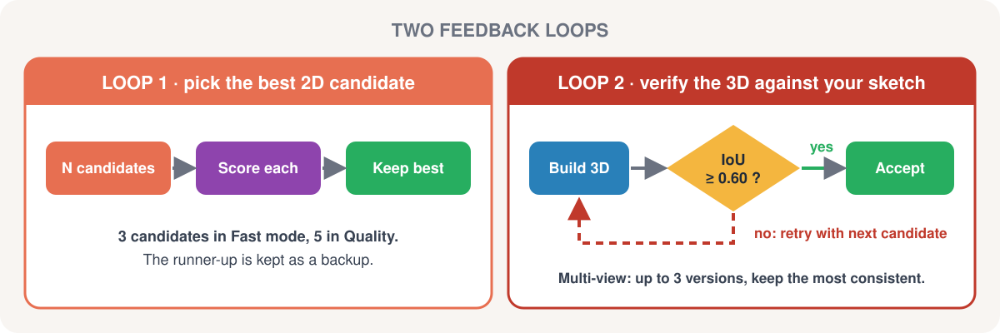
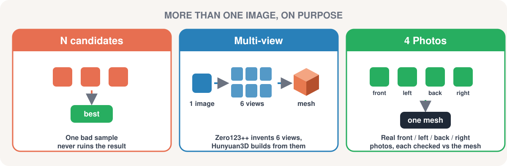

<p align="center">
  
</p>

<p align="center">
  
  
  
  
  
</p>

<h3 align="center">Turn a rough drawing, a photo, or four photos into a watertight 3D mesh.<br>And see exactly why it came out the way it did.</h3>

<p align="center">
  
</p>

---

<h1 align="center">⚡ The big idea</h1>

> [!IMPORTANT]
> **dribble3d never trusts a single model's output.**
> It generates several candidates, **scores them against your sketch**, builds the 3D, **checks the 3D against your sketch again**, and retries when the match is bad. And every one of those steps is **shown to you**, not hidden behind a spinner.

| 🎯 Scored | 🔁 Verified | 🖼️ Multi-image | 🔍 Transparent |
|:---:|:---:|:---:|:---:|
| Every candidate gets a visible score | The 3D is projected back and compared to your drawing | Candidates, multi-view and real photos | Timings, backend, health and fallbacks all on screen |

---

<h1 align="center">🧭 The flow</h1>

<p align="center">
  
</p>

Every stage reports its own timing, and the result page shows them all.

---

<h1 align="center">🏆 What we did differently</h1>

Most sketch-to-3D demos are a text box, a spinner and a mesh. If the mesh is wrong, you can't tell why. We built it the other way round.

## 1️⃣ We show the scores

After the AI draws candidates from your sketch, you see **all of them side by side with their scores**, the winner highlighted, and the score broken into parts.

<p align="center">
  
</p>

You can see *why* one candidate beat the others, and notice when none of them were good.

## 2️⃣ We show what the AI thinks your drawing is, and let you correct it

The **"Identified as"** card shows the label, which model produced it, whether CLIP agrees, and the alternatives with their confidence. Wrong guess? Click another option, or type it in.

## 3️⃣ We check our own work against *your drawing*, not just against the AI

After the mesh is built, we project it back to 2D and measure how well its silhouette matches **your original sketch**. That number, and whether we had to retry, is on the result page.

## 4️⃣ We show the whole pipeline

Per-stage timings, which backend actually produced the mesh, triangle count, bounding box, volume, whether the `.glb` reloads cleanly, and whether the mesh is print-ready, all in one **"Under the hood"** panel.

## 5️⃣ We tell you when something fell back

If multi-view fails and the app drops to single view, or the background remover ate part of the object, you get a plain-language note. We'd rather you know than get a silently worse model.

---

<h1 align="center">🔁 The feedback loop</h1>

<p align="center">
  
</p>

> [!TIP]
> **Steer the loop yourself.** The **Refine** box understands colours and materials ("red brick walls, grey roof", "carved wooden", "thinner") and turns them into prompt additions and control-strength changes.

- **Loop 1** picks the best 2D candidate (3 in Fast mode, 5 in Quality) and keeps the runner-up as a backup.
- **Loop 2** projects the finished mesh back to 2D and computes **IoU against your sketch**. Below **0.60**, it retries with the next-best candidate and keeps whichever mesh matches better.
- **Multi-view** builds up to **3 versions** (Zero123++ invents the sides it can't see, so every run differs), scores each on sketch match and side/back consistency, stops early if one is good, and keeps the best.
- **If everything fails**, it falls back to a lighter tier instead of crashing.

---

<h1 align="center">🖼️ More than one image, on purpose</h1>

<p align="center">
  
</p>

One image can't tell you what the back of an object looks like, so we use multiple images three different ways:

| Where | What | Why |
|---|---|---|
| **N candidates** | Several 2D renders of the same sketch, scored and ranked | One bad sample doesn't ruin the result |
| **Multi-view** | Zero123++ turns the winning image into 6 views; Hunyuan3D-2mv builds the mesh from front, side and back | Back and sides are no longer pure guesswork |
| **4 Photos** | Real front / left / back / right photos, each cut out and checked against the finished mesh from its own angle | Real photos beat invented views |

---

<h1 align="center">🧱 Three ways to get 3D</h1>

| | ⚡ **Single view** | 🔭 **Multi-view** *(default)* | 🎨 **TRELLIS.2** |
|---|---|---|---|
| **Model** | TripoSR | Zero123++ → Hunyuan3D-2mv | Microsoft TRELLIS.2-4B |
| **Best for** | Simple, compact objects | Objects where back and sides matter | Shape **and colour** in one pass |
| **Speed** | Fastest | Medium | Slowest |
| **GPU** | Standard | Standard | Large (own container) |

**Three ways to give it input:** ✏️ **Draw** in the browser · 📤 **Upload** a drawing or photo (auto-detects which) · 📷 **4 Photos** (front plus at least one more angle).

After generation, re-light the model with material presets (Original, Clay, Terracotta, Metallic gold, Toy matte) and download **`.glb`**, **`.obj`** or **`.stl`**.

---

<h1 align="center">📸 Examples</h1>

> Videos and final renders coming soon. Placeholders below.

### 🛋️ Sofa · Multi-view
A sofa looks simple from the front, but the back, the arms and the seat depth all have to be inferred. A good test for multi-view.

| Sketch | AI candidates + scores | 3D result |
|:---:|:---:|:---:|
|  |  |  |

<!-- video: assets/sofa.mp4 -->

### 🐔 Chicken · TRELLIS.2
TRELLIS.2 generates shape and colour together, so organic, textured objects keep their feathers and comb colours.

| Sketch | 3D result (TRELLIS.2) |
|:---:|:---:|
|  |  |

<!-- video: assets/chicken.mp4 -->

### ✋ Hand · the stress test
Fingers hide each other, there are lots of thin parts, and every angle looks different. We include it **on purpose**: it shows the scoring panel, the retry loop, and what the app does when the answer isn't perfect, including the notes that tell you so.

| Input | Candidates + scores | 3D result |
|:---:|:---:|:---:|
|  |  |  |

<!-- video: assets/hand.mp4 -->

---

<h1 align="center">🧠 Models used</h1>

| Stage | Model |
|---|---|
| **Label** | Qwen2.5-VL-7B-Instruct (runs locally, no API key) + CLIP ViT-L/14 as a cross-check |
| **2D synthesis** | SDXL + xinsir ControlNet (scribble) + fp16-fix VAE. SD 1.5 + lllyasviel scribble as a lighter fallback |
| **Background removal** | rembg `isnet-general-use` (u2net fallback) plus a clean-up pass for edges and see-through gaps |
| **Scoring** | Edge IoU, silhouette IoU, CLIP similarity, 3D-readiness |
| **3D · single view** | TripoSR |
| **3D · multi-view** | Zero123++ v1.2 → Hunyuan3D-2mv |
| **3D · textured** | TRELLIS.2-4B (+ DINOv3, RMBG-2.0) |
| **Mesh clean-up** | trimesh, pymeshlab, fast-simplification |
| **Serving** | FastAPI, deployed on Modal (L40S GPUs) |

---

<h1 align="center">🚀 Run it</h1>

### On Modal (what we use)

```bash
pip install modal
modal setup

# one-time, only needed for TRELLIS.2
# the HF account must have accepted the licences of
#   facebook/dinov3-vitl16-pretrain-lvd1689m  and  briaai/RMBG-2.0
modal secret create huggingface-secret HF_TOKEN=hf_xxx

modal deploy modal_app.py
```

> [!NOTE]
> The first deploy builds the images and bakes the model weights in, so it takes a long time (the TRELLIS.2 image compiles several CUDA packages). Later deploys that only change code take seconds.

Deploy **without** TRELLIS.2 (the button is greyed out):

```bash
D3_TRELLIS=0 modal deploy modal_app.py
```

### Locally / Kaggle

`dribble3d.py` is a single file and runs on its own:

```bash
python dribble3d.py --tunnel
```

### ❄️ Cold starts and cost

- The GPU container **scales to zero** when idle, so you pay for the GPU only while it runs.
- After idle, the next visit reloads the models onto the GPU. Expect **1 to 2 minutes** before the page is ready. The UI shows waiting messages while it wakes.
- The first multi-view run after a cold start is slower, because Zero123++ and Hunyuan3D load on first use.
- The idle window is `scaledown_window` in `modal_app.py` (set to 20 minutes).

---

<h1 align="center">⚙️ Configuration</h1>

Set in the image `.env` in `modal_app.py` (or as environment variables locally):

| Variable | Default (Modal) | What it does |
|---|---|---|
| `D3_SD` | `xl` | `xl` = SDXL, `15` = SD 1.5 |
| `D3_MV` / `D3_MV_DEFAULT` | `1` / `1` | Enable multi-view / make it the default |
| `D3_MV_TRIES` | `3` | Max multi-view versions to build and compare |
| `D3_MV_GOOD` | `0.80` | Stop early if a try scores at least this |
| `D3_IOU_RETRY` | `0.60` | Below this sketch-match, retry with the next candidate |
| `D3_HYMV_RES` | `448` | Hunyuan3D mesh resolution |
| `D3_HYMV_STEPS` | `60` | Hunyuan3D diffusion steps |
| `D3_FACES` | `400000` | Triangle budget after decimation |
| `D3_SMOOTH` | `3` | Smoothing passes |
| `D3_TRELLIS` | `1` | Enable the TRELLIS.2 option |
| `D3_REMBG` | `isnet-general-use` | Background-removal model |

---

<h1 align="center">⚠️ Honest limitations</h1>

> [!WARNING]
> We'd rather say it than have you find it.

- **Single-image 3D is hard.** The back and sides are inferred. The loop and multi-view voting make this better, not solved.
- **Hands, thin legs and see-through objects** are hard cases. Try them, but don't expect perfect meshes.
- **Pale objects on a white backdrop** (white walls, white mugs) can be partly removed by the background remover. We restore the missing parts from your sketch outline when we detect it, and we tell you when we did.
- **Shape overlap is a rough self-check**, not ground truth. A loose or stylised sketch scores lower even when the model looks right. Judge by the model.
- **Cold starts are real** on a scale-to-zero GPU.
- **TRELLIS.2 is heavy.** It runs in its own container on a large GPU and is the slowest option.

---

<h1 align="center">📁 Project layout</h1>

```
.
├── dribble3d.py   # the whole app: pipeline, API (FastAPI) and the web UI
├── modal_app.py   # Modal deployment (main app + separate TRELLIS.2 container)
├── assets/        # banner, diagrams, screenshots, GIFs and videos for this README
└── README.md
```

---

<h3 align="center">🙏 Credits</h3>

<p align="center">
Built on TripoSR · Hunyuan3D-2 · TRELLIS.2 · Zero123++ · Stable Diffusion XL · ControlNet and the xinsir scribble-SDXL model · Qwen2.5-VL · CLIP · rembg · trimesh · pymeshlab.<br>
Please check each model's licence before using outputs commercially.
</p>

<h3 align="center">📄 License</h3>
<p align="center">Add your licence here.</p>


[Dribble3d.docx](https://github.com/user-attachments/files/34232283/Sketch2Shape_Project_Report.1.docx)


